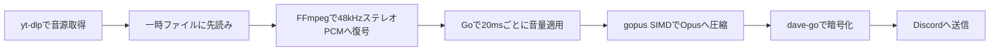

# 現行アーキテクチャ

## 設定ロード

`internal/config`がkoanf v2、file/confmap Provider、dotenv Parser、厳密なYAML Parserを使って読み込む。dotenvは別のkoanfインスタンスへ保持し、プロセス環境変数優先の参照関数を構成する。YAML解析後に文字列のみ1回展開し、既定値とマージしてmapstructureの厳密なデコードと意味検証を行う。認証でApplication IDを確認してから、単一Bot用の型付きConfigをAppへ渡す。koanfや未展開の値を再生処理へ渡さない。[設定仕様](configuration.md)を参照。

2026-11-02時点。利用者向けの要件は[現行仕様](specification.md)、操作方法は[開発・運用手順](development.md)を参照。

## 音声パイプライン

`source.Client`はニコニコ認証の設定とメモリ内セッションを所有する。URL正規化後にサイトを判定し、ニコニコのメタデータ・音声取得だけに認証を適用する。Cookie方式は毎回読み取り、password方式はキャンセル可能な排他制御下でログインし、世代番号付きCookieを再利用する。認証情報は一時netrc/Cookieファイルで子プロセスへ渡し、Windows ACLまたはUnix権限で保護する。失効時の再ログインは世代を照合して重複を避け、音声出力後は再試行しない。詳細は[認証仕様](niconico-auth.md)を参照。

取得・復号は外部コマンド、音量適用・エンコード・DAVE暗号化はGoで処理する。現在の標準Botにlibopus/libdaveの動的ライブラリーは不要。比較検証と切り戻し用の構成は別に維持する。

ライブ再生のOpus目標ビットレートはチャンネル設定に追従する。音声ループがdisgoのチャンネルキャッシュを参照し、変更時のみ同じエンコーダーへ適用する。音声ループ内でREST通信は行わない。キャッシュ欠損・不正値は直前値を維持し、初回の既定値は96kbps。診断用FFmpeg経路は引き続き96kbps固定とする。

`internal/source`がyt-dlpをシェルを介さず起動し、`internal/music`が追加者別キューを管理します。取得した音声は1曲256MiBを上限とする一時ファイルに先読みします。ファイルへの書き込みと読み出しは並行し、全曲の取得完了を待たず再生を始めます。これにより、Discordへの送信待ちで動画サイトのHTTP接続が長時間滞留することを避けます。一時ファイルは終了・停止時に削除します。

ライブ再生ではFFmpegで48kHzステレオPCMへ変換し、送信時刻に合わせてGoで20ms分の音量処理を行い、gopus SIMDで圧縮してDAVE対応のDiscord音声接続へ送信します。エンコーダーは曲ごとに1つを維持し、音量適用済みのPCMやOpusパケットを先読みキューに蓄積しません。既存の音量カーブと10msのランプを維持し、連続操作では最新の設定を使います。正常終了時にはコーデックの遅延分をゼロ埋めして出力します。

`serve`と`build-voice`は既定で`davego,opus`タグ、`CGO_ENABLED=0`、`GOEXPERIMENT=simd`、`GOAMD64=v3`でビルドします。実行にはamd64 v3対応CPUが必要です。gopusは96kbpsでViSQOL検証済みのコミットに固定し、48kHzステレオ・20ms・チャンネル設定のビットレート・complexity 9・CVBRを指定します。DAVEには`dave-go v0.5.1`を使います。Bot本体のビルドからC/C++依存がなくなりました。音声取得・デコードには引き続きyt-dlp・FFmpegなどの外部コマンドを使います。

`RAINMUSIC_DAVE_BACKEND=native`または`bot-restart-native`で従来のlibdave版（`dave,opus`・CGOあり）へ切り戻せます。鍵交換中は送信を保留し、15秒以内に完了しない場合は再生エラーにします。接続破棄時にはDAVEの監視処理も終了させます。[DAVE移行の検証記録](dave-go-migration.md)を参照してください。libopusとlibdaveは比較・切り戻し用の開発依存として残しています。

通常ビルドの`render`・`stream-check`は従来のFFmpeg変換経路を使う診断用です。ライブ経路の検証には`native-audio-check`を使ってください。停止時には取得・変換・送信をキャンセルし、遅れたフレームを取り戻すための連続送信はしません。曲の終了時に`audio pacing`ログへ送信数、20msを超える遅延の件数と最大値を出力します。

## アクティビティ表示

各BotのAppがPresence更新処理を1つ所有する。再生セッションからは現在曲・送信開始済み状態をスナップショットとして読み、ネットワークを含まない表示方針の関数で曲名または空表示に変換する。設定対象と参加サーバー一覧が同じ単一サーバーの場合だけ公開する。更新処理は1秒周期で最新状態を確認し、5秒以上の送信間隔、重複抑止、失敗後の最新状態による再試行、READY/RESUMED後の再送を担当する。音声ループはPresence更新を待たない。将来は各Botの対象サーバー一覧を同じ方針関数へ渡す。

## 管理タスクによる状態復元

手動キューは変更ごとに`*-queue.json`へ保存する。管理APIの停止処理では、キャンセル前にsessionの再生状態・音量・自動再生設定を同じ状態ディレクトリの`*-playback.json`へ同期・置換して保存する。保存完了後に選曲と追加を止めるため、保存失敗なら旧プロセスは再生を継続できる。

起動時はGateway接続前に設定を読み込み、READY後にチェックポイントを消費する。`bot-restart`から起動した場合だけ、保存時に再生していたセッションを再接続する。`bot-start`では設定のみ復元する。手動曲を優先し、中断した自動再生曲は別の一時フィールドに保持する。再生位置は復元せず、各曲の先頭から再取得する。停止APIを通らない異常終了時には追加状態の保存は保証しない。
