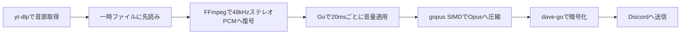

# 現行アーキテクチャ

## 設定ロード

YouTube Data APIのキャッシュは専用mutexで保護し、HTTP通信中は保持しない。キャッシュにない項目だけ通信待ちに入り、待ち終わった時点でキャッシュを再確認して重複要求を防ぐ。全件キャッシュ命中の要求は、別の通信やバックオフに待たされず補完する。

CLIは入口で設定ファイル引数を1回だけ解析し、実行処理には位置引数と型付きOptionsを渡す。`os.Args`を書き換えない。管理制御には絶対パスへ正規化した設定引数を明示的に渡し、独立したコピーを保持させることで、再起動時の設定引き継ぎを維持する。

リスト取り込み用offerに単曲のTrackを保持し、Durationをコピーして元のメタデータから独立させる。ボタン処理はこの情報を結果表示へ再利用する。source.ResultのPlaylistTitleは既存のyt-dlp出力から取得し、リスト名のための追加通信は行わない。

連続失敗通知はセッションごとの `failureNotice` で管理する。通知専用mutexで更新を直列化し、音声・キューのmutexを保持したままDiscordへ送信しない。最初の音声パケットの送信成功で進むplaybackSequenceと通知先を用いて通知のまとまりを区切る。削除済みメッセージへの更新のみ再作成し、その他のRESTエラーはログへ残して再生処理を続ける。

Discordメッセージの共通生成は `internal/discordbot/messages.go` が担当する。操作結果と公開範囲の判定をネットワーク処理から分離し、テキストとEmbedの切り替え時は不要なContent/Embeds/Componentsを明示的に空にする。入力・VC条件を遅延応答より前に検証し、公開応答開始後は公開範囲を変えない。

Data API補完器のキャッシュはタイトル・再生時間・チャンネル・サムネイルを一体で保持する。TrackにChannelID/ChannelTitle/ThumbnailURLを任意JSONフィールドとして保存する。チャンネルURLは検証済みIDから表示時に生成し、Discord EmbedにサムネイルURLを渡す。キュー表示はメタデータ取得を行わない。動画IDが返らなければ5分、取得済みメタデータは24時間キャッシュする。

`source.Client.YouTubeData` は任意のタイトル補完器。共通の `inspect` がyt-dlp出力をTrackへ変換した後に呼ぶため、単曲・リスト・Mix・自動再生候補へ適用される。公式APIへのHTTP処理はGo標準ライブラリを使用し、キーはヘッダーで渡す。動画IDと言語のメモリキャッシュ、50件単位の取得、最大3秒の操作期限を持つ。ゲートで同時のキャッシュミスを直列化し、先行処理の結果を再利用する。表示時や音声取得時にAPIを呼ばない。TrackのTitleSource/TitleLanguageは任意JSONフィールドであり、古い保存状態も読める。実験用yt-dlpプラグインは本番にはロードしない。

YouTubeメタデータ言語は型付きConfigから`source.Client.MetadataLanguage`へ渡し、メタデータ取得時だけ`--extractor-args youtube:lang=CODE`を追加する。ニコニコ認証・音声形式の選択とは独立している。独立診断用Clientも既定は`ja`で、設定ファイルを読む`source-check`は設定値を使用する。

`internal/config`がkoanf v2、file/confmap Provider、dotenv Parser、厳密なYAML Parserを使って読み込む。dotenvは別のkoanfインスタンスへ保持し、プロセス環境変数優先の参照関数を構成する。YAML解析後に文字列のみ1回展開し、既定値とマージしてmapstructureの厳密なデコードと意味検証を行う。認証でApplication IDを確認してから、単一Bot用の型付きConfigをAppへ渡す。koanfや未展開の値を再生処理へ渡さない。[設定仕様](configuration.md)を参照。

2026-11-02時点。利用者向けの要件は[現行仕様](specification.md)、操作方法は[開発・運用手順](development.md)を参照。

## 応答・候補取得の診断

`diagnostics.go`はDiscord応答更新と自動再生候補取得の失敗を、固定の操作名とキャンセル・タイムアウト・ネットワークなどの分類で記録する。トークンや応答本文を含み得る上流エラーの原文は出力しない。候補取得の部分成功はエラー記録とは独立して採用する。

## 音声パイプライン

キューの閲覧は`queue_view.go`が担当し、セッションのロック下でEmbedとボタンを構築する。表示の直列化には再生状態と別のロックを使い、Discord応答の待機中に再生を妨げない。候補の参照は`autoplay.available`、消費は`take`へ分離する。候補取得は世代番号と完了チャネルを持つ非同期処理で、再生中の先行取得と次曲選択が共有する。無効化時は完了待機を解除し、古い取得結果を破棄する。先行取得1回と選曲時の再試行を合わせて最大2回に制限する。

`source.Client`はニコニコ認証の設定とメモリ内セッションを所有する。URL正規化後にサイトを判定し、ニコニコのメタデータ・音声取得だけに認証を適用する。Cookie方式は毎回読み取り、password方式はキャンセル可能な排他制御下でログインし、世代番号付きCookieを再利用する。認証情報は一時netrc/Cookieファイルで子プロセスへ渡し、Windows ACLまたはUnix権限で保護する。失効時の再ログインは世代を照合して重複を避け、音声出力後は再試行しない。詳細は[認証仕様](niconico-auth.md)を参照。

取得・復号は外部コマンド、音量適用・エンコード・DAVE暗号化はGoで処理する。現在の標準Botにlibopus/libdaveの動的ライブラリーは不要。旧実装との比較実験は本番の起動経路とは分離する。

ライブ再生のOpus目標ビットレートはチャンネル設定に追従する。音声ループがdisgoのチャンネルキャッシュを参照し、変更時のみ同じエンコーダーへ適用する。音声ループ内でREST通信は行わない。キャッシュ欠損・不正値は直前値を維持し、初回の既定値は96kbps。診断用FFmpeg経路は引き続き96kbps固定とする。

`internal/source`がyt-dlpをシェルを介さず起動し、`internal/music`が追加者別キューを管理します。取得した音声は1曲256MiBを上限とする一時ファイルに先読みします。ファイルへの書き込みと読み出しは並行し、全曲の取得完了を待たず再生を始めます。これにより、Discordへの送信待ちで動画サイトのHTTP接続が長時間滞留することを避けます。一時ファイルは終了・停止時に削除します。

ライブ再生ではFFmpegで48kHzステレオPCMへ変換し、送信時刻に合わせてGoで20ms分の音量処理を行い、gopus SIMDで圧縮してDAVE対応のDiscord音声接続へ送信します。エンコーダーは曲ごとに1つを維持し、音量適用済みのPCMやOpusパケットを先読みキューに蓄積しません。既存の音量カーブと10msのランプを維持し、連続操作では最新の設定を使います。正常終了時にはコーデックの遅延分をゼロ埋めして出力します。

`serve`と`build-voice`は既定で`davego,opus`タグ、`CGO_ENABLED=0`、`GOEXPERIMENT=simd`、`GOAMD64=v3`でビルドします。実行にはamd64 v3対応CPUが必要です。gopusは96kbpsでViSQOL検証済みのコミットに固定し、48kHzステレオ・20ms・チャンネル設定のビットレート・complexity 9・CVBRを指定します。DAVEには`dave-go v0.5.1`を使います。Bot本体のビルドからC/C++依存がなくなりました。音声取得・デコードには引き続きyt-dlp・FFmpegなどの外部コマンドを使います。

旧libdaveのBot起動経路は廃止した。鍵交換中は送信を保留し、15秒以内に完了しない場合は再生エラーにする。接続破棄時にはDAVEの監視処理も終了させる。比較・相互運用の記録は[DAVE移行の検証記録](dave-go-migration.md)に残す。

通常ビルドの`render`・`stream-check`は従来のFFmpeg変換経路を使う診断用です。ライブ経路の検証には`opus-audio-check`を使ってください。停止時には取得・変換・送信をキャンセルし、遅れたフレームを取り戻すための連続送信はしません。曲の終了時に`audio pacing`ログへ送信数、20msを超える遅延の件数と最大値を出力します。

## アクティビティ表示

各BotのAppがPresence更新処理を1つ所有する。再生セッションからは現在曲・送信開始済み状態をスナップショットとして読み、ネットワークを含まない表示方針の関数で曲名または空表示に変換する。設定対象と参加サーバー一覧が同じ単一サーバーの場合だけ公開する。更新処理は1秒周期で最新状態を確認し、5秒以上の送信間隔、重複抑止、失敗後の最新状態による再試行、READY/RESUMED後の再送を担当する。音声ループはPresence更新を待たない。将来は各Botの対象サーバー一覧を同じ方針関数へ渡す。

## 管理タスクによる状態復元

認証付き管理ステータスは、再生処理の稼働・音声送信開始・送信開始回数だけを追加公開する。曲名・URLは含めない。送信開始回数は各曲の最初の音声パケット送信後に増加する。`bot-restart --after-track`はビルド・事前検証後に回数を記録し、次曲の送信開始または再生停止を待って既存のチェックポイント付き停止・起動を実行する。待機中も読み取り専用の管理タスクを許可し、変更操作は排他制御する。

手動キューは変更ごとに`*-queue.json`へ保存する。管理APIの停止処理では、キャンセル前にsessionの再生状態・音量・自動再生設定を同じ状態ディレクトリの`*-playback.json`へ同期・置換して保存する。保存完了後に選曲と追加を止めるため、保存失敗なら旧プロセスは再生を継続できる。

起動時はGateway接続前に設定を読み込み、READY後にチェックポイントを消費する。`bot-restart`から起動した場合だけ、保存時に再生していたセッションを再接続する。`bot-start`では設定のみ復元する。手動曲を優先し、中断した自動再生曲は別の一時フィールドに保持する。再生位置は復元せず、各曲の先頭から再取得する。停止APIを通らない異常終了時には追加状態の保存は保証しない。
