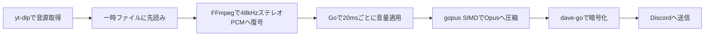

# 現行アーキテクチャ

利用者向けの挙動は[現行仕様](specification.md)、操作方法は[開発・運用手順](development.md)を参照。

## 設定と起動

CLIは入口で設定ファイル引数を1回だけ解析し、実行処理には位置引数と型付きOptionsを渡す。`os.Args`を書き換えない。管理制御には絶対パスへ正規化した設定引数を明示的に渡し、独立したコピーを保持させることで、再起動時の設定引き継ぎを維持する。

`internal/config`がkoanf v2、file/confmap Provider、dotenv Parser、厳密なYAML Parserを使って読み込む。dotenvは別のkoanfインスタンスへ保持し、プロセス環境変数優先の参照関数を構成する。YAML解析後に文字列のみ1回展開し、既定値とマージしてmapstructureの厳密なデコードと意味検証を行う。認証でApplication IDを確認してから、単一Bot用の型付きConfigをAppへ渡す。koanfや未展開の値を再生処理へ渡さない。[設定仕様](configuration.md)を参照。

## メタデータ取得と認証

操作の認可は`internal/authorization.Service`を参照し、Cedar Go v1.8.0の実装は同パッケージに閉じ込める。アプリ独自の入力・判定型を使い、CedarのEntityやスキーマ型をDiscord処理へ公開しない。設定読込時に全ルールを検証し、App初期化時に不変のポリシー集合を構築する。

Discordアダプターは評価ごとにRESTで所属ロールを取得し、Gatewayで維持するロール・チャンネル情報から閲覧権限を計算する。認可エンジン内では外部I/Oを行わない。状態変更ではセッションロック外で認可し、ロック内で対象VC・曲・世代・参加状態を照合する。キューの`access_scope`は認可対象VCを保持し、追加・再開・VC移動時に既存の保存順序制御で書き込む。[認可モデル](authorization-model.md)と[検証記録](authorization-evaluation.md)を参照。

YouTube Data APIのキャッシュは専用mutexで保護し、HTTP通信中は保持しない。キャッシュにない項目だけ通信待ちに入り、待ち終わった時点でキャッシュを再確認して重複要求を防ぐ。全件キャッシュ命中の要求は、別の通信やバックオフに待たされず補完する。

Data API補完器のキャッシュはタイトル・再生時間・チャンネル・サムネイルを一体で保持する。TrackにChannelID/ChannelTitle/ThumbnailURLを任意JSONフィールドとして保存する。チャンネルURLは検証済みIDから表示時に生成し、Discord EmbedにサムネイルURLを渡す。キュー表示はメタデータ取得を行わない。動画IDが返らなければ5分、取得済みメタデータは24時間キャッシュする。

`source.Client.YouTubeData` は任意のタイトル補完器。共通の `inspect` がyt-dlp出力をTrackへ変換した後に呼ぶため、単曲・リスト・Mix・自動再生候補へ適用される。公式APIへのHTTP処理はGo標準ライブラリを使用し、キーはヘッダーで渡す。動画IDと言語のメモリキャッシュ、50件単位の取得、最大3秒の操作期限を持つ。ゲートで同時のキャッシュミスを直列化し、先行処理の結果を再利用する。表示時や音声取得時にAPIを呼ばない。TrackのTitleSource/TitleLanguageは任意JSONフィールドであり、古い保存状態も読める。実験用yt-dlpプラグインは本番にはロードしない。

YouTubeメタデータ言語は型付きConfigから`source.Client.MetadataLanguage`へ渡し、メタデータ取得時だけ`--extractor-args youtube:lang=CODE`を追加する。ニコニコ認証・音声形式の選択とは独立している。独立診断用Clientも既定は`ja`で、設定ファイルを読む`source-check`は設定値を使用する。

`source.Client`はニコニコ認証の設定とメモリ内セッションを所有する。URL正規化後にサイトを判定し、ニコニコのメタデータ・音声取得だけに認証を適用する。Cookie方式は毎回読み取り、password方式はキャンセル可能な排他制御下でログインし、世代番号付きCookieを再利用する。認証情報は一時netrc/Cookieファイルで子プロセスへ渡し、Windows ACLまたはUnix権限で保護する。失効時の再ログインは世代を照合して重複を避け、音声出力後は再試行しない。詳細は[認証仕様](niconico-auth.md)を参照。

## Discord表示とエラー

リスト取り込み用offerに単曲のTrackを保持し、Durationをコピーして元のメタデータから独立させる。ボタン処理はこの情報を結果表示へ再利用する。source.ResultのPlaylistTitleは既存のyt-dlp出力から取得し、リスト名のための追加通信は行わない。

連続失敗通知はセッションごとの `failureNotice` で管理する。通知専用mutexで更新を直列化し、音声・キューのmutexを保持したままDiscordへ送信しない。最初の音声パケットの送信成功で進むplaybackSequenceと通知先を用いて通知のまとまりを区切る。削除済みメッセージへの更新のみ再作成し、その他のRESTエラーはログへ残して再生処理を続ける。

Discordメッセージの共通生成は `internal/discordbot/messages.go` が担当する。操作結果と公開範囲の判定をネットワーク処理から分離し、テキストとEmbedの切り替え時は不要なContent/Embeds/Componentsを明示的に空にする。入力・VC条件を遅延応答より前に検証し、公開応答開始後は公開範囲を変えない。

利用者へ表示できる操作エラーは`operationError`の固定コードで識別し、日本語表示は一か所で定義する。エラーのラップは`errors.As`で解き、外側の診断文は表示しない。上流の文字列が同じ文面でも、型が一致しなければ信用しない。認証エラーはsource側の型付き分類を使う。

`diagnostics.go`はDiscord応答の作成・更新・遅延応答と自動再生候補取得の失敗を、固定の操作名とキャンセル・タイムアウト・ネットワークなどの分類で記録する。拒否応答の送信失敗も対象とする。トークンや応答本文を含み得る上流エラーの原文は出力しない。候補取得の部分成功はエラー記録とは独立して採用する。

キューの閲覧は`queue_view.go`が担当し、セッションのロック下でEmbedとボタンを構築する。表示の直列化には再生状態と別のロックを使い、Discord応答の待機中に再生を妨げない。候補の参照は`autoplay.available`、消費は`take`へ分離する。候補取得は世代番号と完了チャネルを持つ非同期処理で、再生中の先行取得と次曲選択が共有する。無効化時は完了待機を解除し、古い取得結果を破棄する。先行取得1回と選曲時の再試行を合わせて最大2回に制限する。

## キュー編集と操作画面

キューのサブコマンドは`queue_command.go`が振り分けと全消去確認を担当する。全消去は確認時の待機項目ID集合を保持し、確定時に現在の集合と照合する。編集画面と確認画面は所有者・メッセージ・VC・セッション・期限を共通の画面管理で検証する。

キュー編集は`queue_editor.go`が画面と選択状態、`queue_editor_actions.go`がDiscordイベントと表示用の権限取得、`queue_edit_mutations.go`が変更直前の認可・セッション確認を担当する。表示用の認可は1回の操作者メンバー情報取得から項目ごとの許可を評価し、実変更は改めて所属情報を取得する。画面mutexは操作を直列化し、古い世代を拒否する。キュー本体の`music/edit.go`は項目IDと追加者内の期待順序を照合し、既存の保存境界で変更を永続化する。Discord送信中はセッション・キューのロックを保持しない。追加者メニューの表示名は表示ページの対象だけをキャッシュまたはDiscord APIから取得し、取得失敗時は保存済みの名前を使う。表示名の取得結果を認可の根拠にはしない。

## 再生セッションと接続

失敗後の所属確認では、通知・キャッシュで確定できない場合に`GET /guilds/{guild.id}/voice-states/@me`を確認期限内に一度呼ぶ。Voice Stateの取得成功または`10065 Unknown Voice State`だけを所属判定に使い、一般の404・権限エラー・通信失敗は未確認とする。照会中に届いた所属通知をHTTP応答で上書きしない。キャッシュ不在や時間経過だけで未参加とは判定しない。

サーバー通知だけでtokenまたはendpointが変わった場合も、確認済み所属を用いてTransportを更新する。endpointがnullなら旧Transportを破棄し、再割り当てを待つ。所属通知より先にサーバー更新を受けた場合は、その通知を後続の所属変更まで保持する。これにより、更新後の接続確立が先に完了してもVC移動の通知を取りこぼさない。同値の通知だけでは接続を作り直さない。

session.muは現在曲・接続先・自動再生・操作世代を保護する。runningは再生ループの稼働、startedは最初の音声送信完了を表す。stoppedは利用者操作や切断による停止、shuttingDownは管理保存の確定後を表し、異なる状態なので単一のフラグに統合しない。

接続開始はconnectingと対象VCを記録してからsession.muを解放する。Open完了後は停止・管理終了を再確認し、古い成功は破棄する。接続中のVC移動は接続管理の新世代へ引き継ぐ。接続中の再開操作には進行中の状態を返し、二重に開始しない。曲追加は既存の開始処理へ合流させる。受付時の権限確認に加え、取得後にもVC・epoch・変更受付状態を確認する。

URLなし`/play`の`resumeRequest`は、受付後の再生要求と元の応答の寿命を別々に管理する。受付応答を試みてから非同期で接続・旧ループ終了待ちを開始し、最初のWrite成功、対象なし、音源失敗、接続失敗、中止で結果を一度だけ確定する。接続期限へ音源準備時間は含めない。移動は応答だけを終了させ、停止・外部退出・管理終了は要求を失効させる。`playbackRevision`は開始の失効判定に使い、VC移動や待機キュー消去で変わる`epoch`とは分ける。古い再生ループは自分が保持した要求だけを終了でき、失敗直後に受けた新しい再開要求を取り消さない。待機キューの消去は現在曲や自動再生を止めず、開始対象がなくなった場合に空として完了する。

切断時はsession.mu内で停止・接続参照の解除・closing待機チャネルの設定を行い、接続CloseとDAVE後処理を別goroutineで実行する。後処理中の追加・再接続は拒否し、旧接続の破棄が新接続へ影響しないようにする。管理終了は再生ループと切断完了の双方を待つ。切断中も状態照会はsession.muを短時間で取得できる。

再生セッションは現在曲・キュー・音量・自動再生を所有し、音声接続は安定した一つの管理オブジェクトを通して使う。実際のVC所属と復旧判断の正本は接続管理に置き、再生側のchannelは権限・通知・無人判定用の観測値として同期する。現在曲の履歴に保存した開始VCは移動しても変更しない。

`voice_connection.go`は所属・サーバー更新・通信切断・期限切れを一か所で直列化する。状態は未接続、情報待ち、接続確立中、送信可能、復旧待ち、復旧失敗、終了済みを区別する。30秒の復旧期限は内部リトライや重複通知で延長しない。接続世代を更新してから旧接続を無効化し、通信処理は状態mutexの外で実行する。4014・4022は所属変更やサーバー更新を待ち、4015では既存通信のResumeを試みる。外部退出と明示停止は自動再参加しない。トークン値を通知の識別子として使わない。移動前後で同じ値が通知される場合も、新しく受信した接続先通知を所属変更と組み合わせて使う。所属より先に届いた同値の通知は保留し、それだけでは送信可能な接続を作り直さない。

`voice_transport.go`は世代ごとのdisgo Conn・WebSocket・UDP・DAVEを所有する。disgo Connの所属変更関数は無効化しておき、通信資源の破棄がVCからの退出を送らないようにする。新しい所属とサーバー情報を組み合わせて接続し、通信暗号鍵とDAVEの準備後に送信可能にする。音声送信前に発話開始を通知する。旧世代のDAVEは別インスタンスであるため、遅い暗号化イベントから新世代の状態を書き換えられない。

音声WebSocketには`voice_socket.go`の実装を使う。disgo v0.19.6のGatewayはHeartbeat開始・終了に競合があり、Heartbeat異常時の内部再接続も接続管理の判断を迂回するため使用しない。プロトコルの型・デコードと通信暗号化はdisgoを利用し、WebSocketの読取り・Heartbeat・送信は接続単位で終了できるようにする。Resumeでも旧接続の処理から新接続を閉じられない。DAVE通知は`voice_dave_events.go`で転送し、DAVEラッパーのmutexで暗号化との競合を防ぐ。Transportの破棄はイベント処理と音声送信の終了後にDAVEを解放する。

通信層の新規接続とResumeは別のメソッドで指定する。シーケンス未受信は-1で表し、番号0や折り返しと区別する。ResumeはResumed受信で成立し、Speakingを次の送信前に再通知する。DAVE準備は接続管理が復旧全体の残り時間で待ち、二度目のResumeを送らない。待機中の切断も直ちに復旧失敗へ反映する。成功済みの接続試行は現在試行の参照から外し、次の復旧期限切れを誤分類しない。新規接続では前のSSRC・シーケンス・接続成立状態を初期化する。

UDP探索とDAVE処理はTransportに属する単一ワーカーへ渡し、WebSocket受信とHeartbeat ACK処理を待たせない。SessionDescriptionを含むイベントの受信順を維持する。キューは64件で、超過時は接続失敗を通知する。ワーカーは接続確立後とResume後も継続し、Transport破棄時に終了を待つ。ReadyのUDP探索・SelectProtocol送信はTransportが直接実行し、失敗を接続試行へ返す。新規接続へのResumed、ResumeへのReady、Hello前の成立通知を拒否し、同一ソケットでのReady重複による再探索を防ぐ。DAVEを含む終了待ち上限は[改善計画](voice-handshake-plan.md)に従って引き続き変更する。

`voice_reconnect.go`は接続管理ごとに一つの復旧処理を所有する。通常の通信断・1006・4015では既存通信を保持してResumeを最大2回試し、失敗時は新規参加要求へ進む。各ResumeのResumed受信まで・参加通知待ち・退出確認は最大5秒、全体は30秒。参加通知だけが届く場合は、対象VCと参加権限を確認し、退出通知を確認してから一度だけ再参加する。自動再参加は直近5分で最大2回、明示的なOpenは別の試行として扱う。権限を確認できない場合は安全側に停止する。参加・退出要求の送信失敗は最大3回のバックオフ付き試行で打ち切り、通知待ちとは区別する。

停止・外部退出・再接続禁止の応答は復旧をキャンセルする。移動通知は古い復旧処理を無効化し、新しい所属と接続先情報を優先する。復旧中の再移動でも全体期限を延ばさない。自動退出の確認中は再生側に一時的な未所属を伝えず、現在曲と再生設定を保持する。新規接続ではDAVEを含む通信資源を作り直し、Resumeでは保持する。最終失敗時は現在曲を保持して停止し、URLなしの`/play`で曲頭から再試行する。

参加通知待ちは、所属と接続先の両通知を使ってハンドシェイクを開始した時点で終了する。接続先オブジェクトを消費した後も、この事実は復旧処理に保持する。以降の接続失敗では追加の退出・再参加を行わず、失敗段階を記録して停止する。通知が不足した場合だけ一度の再参加を許し、再参加後も通知待ちは5秒、ハンドシェイクは全体期限の残り時間に制限する。

要求先のVCと確認済み所属は別に保持する。所属通知で確認したVCは接続失敗・通知オブジェクトの消費・Transport破棄では消さず、退出通知で未所属へ更新する。失敗後の明示的なOpenでは、所属ありなら退出確認付き再参加、未所属なら通常参加を選ぶ。未確認の場合はキャッシュと新しい通知で最大5秒確認し、判定できなければ`membership_confirmation`で停止する。キャッシュに項目がないことだけでは未所属と断定しない。ChannelIDは再生セッションが追従する論理的な接続先として維持し、再参加中の一時的な退出で再生状態を失わせない。

通知不足による自動再参加にも同じ所属確認を適用する。既に未所属と確認できる場合は退出要求と退出待ちを省き、未確認の場合は目標VCを根拠に退出要求を送らない。権限確認と再試行上限はどちらの場合も維持する。

接続管理のWriteAudioは切り替え中に同じOpusフレームを待機させる。有限の先読みバッファで生成側にも待ちを伝え、送信成功時だけ再生位置を進める。復旧失敗は曲の失敗と区別し、再生側のsuspendVoiceLockedで現在曲・自動再生設定・履歴の同一性を保持して停止する。手動曲はキューのcurrentをFinishせず、自動曲は再開用の参照を保持する。管理保存ではRecoveryHeldを記録し、停止状態のまま復元する。明示的な /play は現在曲を先頭から再開する。

再生ループの`running=false`だけでは終了済みと扱わない。次の開始前に旧ループの完了を最大5秒待ち、未完了なら新しいループを作らない。待機中はセッションロックを解放し、停止によるキャンセルを優先する。旧ループの復元トレース終了は、そのループが開始時に保持した参照に対して行い、後の再生のトレースを終了させない。

再生失敗通知はセッションごとの単一ワーカーで直列送信する。再生ループは通知内容のコピーを最大16件のキューへ渡して終了でき、REST完了を待たない。滞留時は古い通知を最新の状態へ置き換え、置換件数をログへ記録する。送信前に通知先と再生シーケンスを確認し、VC移動や次の音声開始で古くなった通知を破棄する。個々のREST通信は10秒以内とし、アプリ終了時はワーカーをキャンセルして既存の終了期限内で完了を待つ。

`haltPlaybackLocked`は曲の連続失敗・明示停止用で自動再生もOFFにし、`stopLocked`はVC接続も終了する。接続復旧失敗による停止とは分ける。移動後の権限・通知先・無人タイマーの更新は`voice_state.go`で行う。

## キューと永続化

`internal/history`は閲覧用履歴のSQLite保存層を担当する。moderncと`database/sql`を使い、sqlc生成コードは`internal/history/historydb`へ隔離する。再生単位IDの一意制約で再試行を重複登録せず、追加とVCごとの古い履歴削除を同一トランザクションで行う。閲覧開始時の最大IDと件数を保持し、新しい記録をページへ混入させず、保持上限による削除を検出して更新を要求する。初期スキーマは`user_version=1`とし、未知の将来版を開いて変更しない。

`internal/discordbot/history_view.go`は本人専用の履歴画面を管理する。画面ごとに元のVC、本人、メッセージID、操作世代、期限、DBスナップショットを保持し、操作時に検証する。外部取得中は同じ画面での後続操作を待たせず拒否する。再追加では単曲を再取得してからVCとセッション世代を再確認し、既存の`acceptAt`に渡す。履歴の表示モデルを再生キューとして直接流用しない。

最初の送信成功時に再生単位IDと日時を確定し、最大128件の保存待ちへコピーを渡す。DB処理はセッションのロック外の専用workerが担当する。保存は1回2秒、最大3回で打ち切る。管理チェックポイントに同じ記録を保持し、再開時には同じIDで再保存するため、保存済みなら重複せず、未保存だった場合は元の日時で再試行できる。管理終了は凍結後に最大10秒の保存待ちを行う。履歴保存の失敗は再生停止の理由にせず、ログへ記録する。

選曲済みの手動曲は、再生処理へ引き渡す前でもキューの現在曲として保存される。明示停止後のチェックポイントは、この選曲済み曲も終了させる。セッションの再生中表示への反映を待たない。

セッションのキュー保存はqueueSavingチャネルで直列化する。待機中とキューI/O中はsession.muを解放し、待機後の操作条件を再確認する。キュー操作のコールバックはセッション状態に触れない。停止・状態照会・音声送信はこの待機チャネルを使用しない。

キューはmutationMuで変更と保存順序を直列化し、muでメモリ状態を保護する。保存用JSONをmu内で確定してからmuを解放して書き込み・同期・置換を行うため、保存中もSnapshotを取得できる。変更操作は保存完了まで戻らず、PersistenceErrorも進行中の変更保存を待って結果を返す。

queueSavingは次のキュー変更と管理保存を待たせるが、停止・音声送信・状態照会は待たせない。追加保存後にはepochを再確認し、保存中に停止された場合は再生を開始しない。空の追加や容量超過では正常保存済みの内容を書き直さず、直前の保存失敗がある場合は再試行する。

UDPの探索と送信には`voice_udp.go`を使う。探索の期限は5秒と親期限の短い方で、キャンセル時は実ソケットを閉じてReadを中断する。成功後は探索contextから切り離してResumeでも同じソケット・RTP番号を維持する。Closeは探索や送信のmutexを待たずにI/Oを中断する。RTPヘッダーの作成とソケット所有をアプリで扱い、通信暗号化はdisgo、メディア暗号化はDAVEを利用する。Botは受信音声を使わないため、このUDP部品の音声受信APIは未対応エラーを返す。

接続確立中のエラーは最初の原因を一度だけ記録し、DAVE待機中のWebSocket切断もfactoryへ返す。確立後の切断は接続管理へ通知する。DAVEコールバックからのWebSocket送信失敗も切断通知へ合流し、依存ライブラリ内でエラーが失われても待ち続けない。SessionDescriptionでは通信鍵を設定してからDAVEを初期化する。解放済みDAVEへのイベント適用と暗号化は拒否する。DEBUGにはDAVEイベントのopcode・シーケンスと処理後の安全な状態・統計を残し、失敗時には最後のスナップショットを参照する。鍵やMLS本文を診断へ渡さない。

接続factoryとTransportの後始末は、Appが共有する最大8枠の資源管理で追跡する。現在の単一Bot・単一サーバー構成で、稼働中の1接続に加え、連続移動による旧世代の終了待ちを許容する上限である。枠はfactoryが資源なしで終了するか、Transportの実際のCloseが完了するまで保持する。全枠が占有された場合は新しいfactoryを作らず、`cleanup_backlog` / `resource_limit`として失敗を記録する。待機期限切れを資源解放と見なして枠を再利用しない。

停止時の解放待ちは呼出元の期限と5秒の短い方とし、超過した後始末は管理対象に残す。DAVEの解放責任は接続生成時にTransportへ移し、Appの残存登録の回収と二重に解放しない。Transportは送信を無効化し、ソケットを閉じ、WSの接続・受信・Heartbeatとイベント処理の終了を待ってからDAVEを解放する。後始末自身はDiscordへの退出要求を送らない。

DAVEの準備確認は接続管理の状態ロック外で行う。確認中の停止・移動・期限切れを妨げず、成功が返った時点で接続世代と状態を再確認する。失効した接続の準備完了によって、停止済みの接続を送信可能へ戻さない。

Transportの準備状態は順序付きワーカーがDAVEイベント処理後と10ms間隔で確認し、atomicな値として公開する。SessionDescription処理前には準備完了を公開せず、DAVEイベントの適用開始時に前の結果を無効化する。接続factoryと復旧待ちはこの値を参照するため、DAVEのReady呼出しが遅れても期限判定を継続できる。送信時は実際のDAVE状態を再確認し、暗号化の可否を古いスナップショットだけで決めない。確認処理を別の無制限なgoroutineへ逃がさず、遅い処理の寿命もTransportの解放追跡に含める。

DAVE送信コールバックの失敗は`dave_send_failed`として接続を失効させる。初期接続なら試行失敗、確立後なら保持停止とし、同じMLS状態をResumeで再利用しない。URLなし`/play`では新しい接続・DAVEを作る。dave-go v0.5.1の`retry.go`は特定のエラー文字列で再試行し、`mls.go`のcommit送信失敗時の巻き戻しもその分類に限られるため、一般の送信失敗からの継続は保証しない。元のエラーは原因として保持し、分類だけをログへ出す。失効後のコールバックは送信・復旧通知を繰り返さない。

Transport失効時は、プロトコル処理のロック待ちより先にdave-goのCloseを呼んで内部再試行とwatchdogのキャンセルを通知する。DAVEは終了待ちを修正した上流コミット`a2b0c8c1b872`に固定する。この版は監視処理の開始と終了をWaitGroupで追跡し、Close後の新規開始を禁止する。Transportの後始末では送信・イベント処理の終了後、プロトコルロックを持たずに`WaitShutdown`を待つ。監視処理が終了するまで資源枠を解放せず、5秒を超える待機は既存の解放遅延診断に記録する。旧v0.5.1の`WaitShutdown`はキャンセル通知しか待たないため、この保証に使用できない。

接続試行の進行記録は、現在段階・直前の完了段階・段階所要時間・直近の受信opcodeと、実際の順序付きワーカーが処理しているopcodeを分けて保持する。キューへの投入完了をイベント処理の完了とは見なさない。同じ段階の重複報告は開始時刻を変更せず、試行終了後の受信や処理完了で失敗時点の診断を上書きしない。

接続確立には段階別タイマーを設け、期限は次の上限と全体の残り時間の短い方とする。段階が進んでも全体30秒は延長せず、同じ段階の重複報告では段階期限も延長しない。旧段階のタイマーは新段階を失敗させず、成功確定と期限切れは排他的に扱う。

| 段階 | 上限 |
| --- | --- |
| WebSocket接続、Hello待ち、Ready待ち、SessionDescription待ち | 全体30秒の残り時間 |
| Identify送信、UDP探索、SelectProtocol送信、通信鍵設定 | 5秒と全体の残り時間の短い方 |
| DAVE準備 | 全体30秒の残り時間 |

応答待ちは従来の全体期限を維持する。5秒は既存のWS送信・UDP探索の上限を基準とし、同じ接続確立処理に属する通信鍵設定にも適用する。WS送信の5秒には他の送信処理との排他待ちも含め、呼び出し元のキャンセル・期限切れと接続runの終了で待機を中断する。Resumeの5秒とその後のDAVE待機は、別の復旧試行の期限管理に従う。

WSイベントは受信元runの診断コンテキストを保持したまま順序付きキューへ渡す。Resume後のイベントを初回接続のコンテキストへ戻さず、キューで待機していた旧runのイベントも新runの記録へ付け替えない。ResumeのDAVEイベント診断も接続管理の有限バッファを経由し、出力先の待機をイベント処理へ持ち込まない。

Resumeは試行ごとに段階・受信イベント・処理中イベントの記録を持ち、初回接続の記録を再利用しない。失敗時の診断にはその試行の世代と進行記録を添える。Resumed受信までの試行が終了したら記録を確定し、現在試行の参照から外す。その後のDAVE待機や遅いイベントで、終了済み試行の段階・所要時間を更新しない。Voice Gateway v8のResumeには`seq_ack`を送る。disgo v0.19.6の送信型のタグ差異は送信境界で補正し、実際のWebSocketペイロードをテストする。ハンドシェイクの失敗確定時は原因を保存してから試行contextをキャンセルし、Ready前でも親期限を待たずに接続処理を終了する。

Transportの音声Write・終了フレーム送信・Resumeは、状態mutexとは別の送信枠で直列化する。送信枠の待機は呼び出し元のキャンセル・期限切れとTransport失効で中断し、通信待ちやDAVEの準備確認中に状態mutexを保持しない。Closeは実I/Oを中断した後、実行中の送信が返ってからDAVEを解放する。Speaking通知の遅い完了後にも失効を確認し、停止済みのTransportで音声送信を開始しない。

接続確立の段階タイマーと診断・トレースは同じ進行記録とmutexを参照する。段階遷移と期限設定を一緒に確定し、失敗確定後は次段階へ進めない。失敗ログには実際の段階期限と、それが個別段階の上限か全体復旧期限かを添える。原因として確定した段階は、後始末中の観測状態で上書きしない。

SessionDescriptionはSelectProtocol送信後にTransportごとに一度だけ適用する。送信前の通知は`session_description`の矛盾として拒否し、鍵設定とDAVE初期化を実行しない。同じ暗号方式・鍵・初期DAVE版の再通知は診断を残して無視し、通信鍵とDAVEを再初期化しない。異なる内容の再通知は`session_description`の矛盾として接続を失効させる。新規接続やVC移動での再設定は、新しいTransportが担当する。DAVEの版変更は専用イベントで処理する。外部送信者パッケージなど、SessionDescriptionより先に届くDAVE通知は受信順に渡す。

## 音声パイプライン

DAVEの送信許可は、依存側の`Ready()`とMLSの劣化状態を併せて判定する。準備中のprotocol 0と実行済みのtransport-onlyを区別し、旧ratchetが残っていてもMLS復旧中はフレームを保持する。接続管理はTransportの準備状態を20ms間隔で監視し、曲の送信が中断されてもDAVE復旧時に期限を解除する。世代交代で監視をキャンセルし、Resumeの進行判断は既存の復旧処理に委ねる。

`packet.go`は送信前の自動再生世代・手動曲優先・キャンセルを検査し、UDP Write中はsession.muを保持しない。送信完了後にもキャンセル・停止・現在曲の同一性を確認してから、開始状態・履歴・進行時間を更新する。既に許可した1パケットは停止操作と並行して送信中になり得るが、遅延完了で停止状態を再生中へ戻さない。

取得・復号は外部コマンド、音量適用・エンコード・DAVE暗号化はGoで処理する。現在の標準Botにlibopus/libdaveの動的ライブラリーは不要。旧実装との比較実験は本番の起動経路とは分離する。

ライブ再生のOpus目標ビットレートはチャンネル設定に追従する。音声ループがdisgoのチャンネルキャッシュを参照し、変更時のみ同じエンコーダーへ適用する。音声ループ内でREST通信は行わない。キャッシュ欠損・不正値は直前値を維持し、初回の既定値は96kbps。診断用FFmpeg経路は引き続き96kbps固定とする。

`internal/source`がyt-dlpをシェルを介さず起動し、`internal/music`が追加者別キューを管理します。取得した音声は1曲256MiBを上限とする一時ファイルに先読みします。ファイルへの書き込みと読み出しは並行し、全曲の取得完了を待たず再生を始めます。これにより、Discordへの送信待ちで動画サイトのHTTP接続が長時間滞留することを避けます。一時ファイルは終了・停止時に削除します。

ライブ再生ではFFmpegで48kHzステレオPCMへ変換し、送信時刻に合わせてGoで20ms分の音量処理を行い、gopus SIMDで圧縮してDAVE対応のDiscord音声接続へ送信します。エンコーダーは曲ごとに1つを維持し、音量適用済みのPCMやOpusパケットを先読みキューに蓄積しません。既存の音量カーブと10msのランプを維持し、連続操作では最新の設定を使います。正常終了時にはコーデックの遅延分をゼロ埋めして出力します。

`serve`と`build-voice`は既定で`davego,opus`タグ、`CGO_ENABLED=0`、`GOEXPERIMENT=simd`、`GOAMD64=v3`でビルドします。実行にはamd64 v3対応CPUが必要です。gopusは96kbpsでViSQOL検証済みのコミットに固定し、48kHzステレオ・20ms・チャンネル設定のビットレート・complexity 9・CVBRを指定します。DAVEには`dave-go v0.5.2-0.20261010151814-a2b0c8c1b872`を使います。Bot本体のビルドからC/C++依存がなくなりました。音声取得・デコードには引き続きyt-dlp・FFmpegなどの外部コマンドを使います。

旧libdaveのBot起動経路は廃止した。鍵交換中は送信を保留し、30秒の接続復旧期限を超えた場合は現在曲を保持して停止する。接続破棄時にはDAVEの監視処理も終了させる。比較・相互運用の記録は[DAVE移行の検証記録](dave-go-migration.md)に残す。

通常ビルドの`render`・`stream-check`は従来のFFmpeg変換経路を使う診断用です。ライブ経路の検証には`opus-audio-check`を使ってください。停止時には取得・変換・送信をキャンセルし、遅れたフレームを取り戻すための連続送信はしません。曲の終了時に`audio pacing`ログへ送信数、20msを超える遅延の件数と最大値を出力します。

## ヘルプ表示

`internal/helpui`は再生状態に依存しないガイド・リファレンスを構築する。コマンド登録定義から書式・引数を生成し、文章と使用例は別データで管理する。同じページ一覧を直接指定、オートコンプリート、二つの選択メニューで参照する。コマンドリンク用の登録IDはGateway接続前に取得し、取得失敗時はコード表記で表示する。

`/help`とヘルプのコンポーネントは再生セッションを取得せず処理する。コンポーネントIDに所有者、表示開始から15分の期限、起動ごとの識別子を持たせる。画面移動では期限を延長せず、再起動前の画面は拒否する。個別画面の状態をサーバー側の無制限な一覧に保持しない。

## 運用ログ

トレース基盤は`internal/telemetry`が担当し、CLIでProviderを生成してAppへ注入する。SDK・OTLP/HTTP exporterはv1.47.0。既定は無効で、ログのContextに有効なSpanContextがある場合のみ`trace_id`・`span_id`・`trace_sampled`をルート属性へ追加する。対象と完了条件は[計装方針](tracing-plan.md)を参照する。

接続管理は有限の復旧単位に`voice.recovery`、通信確立試行に`voice.connect`を作る。`voice.notifications`は通知収集開始から必要な通知が揃うまでを表し、通信確立の開始前に終了する。既存の`voice.wait`は監督処理がreadyまたは退出確認まで待つ区間で、`wait_until`に待機対象を記録する。`stage=voice_notifications`でも通知だけの時間を表すものではない。Resume、参加・退出要求、再入室権限確認も子spanとして記録する。通信確立はWebSocket接続、Hello、Identify/Ready、UDP探索、プロトコル選択、SessionDescription、通信鍵設定、DAVE準備に分ける。期限切れ時には試行の最後の観測段階を保持し、遅延完了が終了済みspanや新世代を変更しない。

復旧の開始契機、監督処理の復旧ID、接続試行の番号・世代を属性に持たせる。復旧段階の変更は残り時間付きのeventとし、SDKの件数上限を適用する。接続試行は復旧全体の期限を共有し、監督処理の段階待ちは段階期限と復旧期限のどちらで切れたかを区別する。通知ログも観測時のContextを使用して同じトレースへ関連付ける。

失敗時の分類と数値診断は既存ログの許可リストを再利用し、WebSocket切断コード、HTTPステータス等を`asterinmusic.*`属性へ記録する。生エラーの文字列は属性・event・statusに渡さない。Resumeの期限切れは試行期限と復旧全体の期限を区別する。

状態適用からの`playback.restore`は、停止状態なら設定復元で、再生状態なら最初の音声送信成功または準備失敗・中断で終了する。接続後から音声開始までを`playback.restore_prepare`で計測する。音声開始の既存観測処理から、実際の最初の送信成功時刻をspanの終了時刻として渡すため、observerの遅延を音声準備時間に含めず、フレーム経路に新しいobserverを作らない。開始した再生のID・VC IDも関連付ける。終了時に記録中spanの参照を解放し、ログ用にはSpanContextだけを保持する。後続曲は終了済みの復元Contextを引き継がない。`voice.speaking`はSpeaking開始要求時のみ作り、接続・Resumeとの関係をlinkで記録する。ローカルJaegerでの閲覧と実機の復元・VC往復を確認済み。詳細は[検証記録](tracing-verification.md)を参照する。

送信は最大1024spanの非ブロッキングキュー、128span単位、最大1秒待ち、送信期限2秒で行う。再送は無効、終了flushは最大3秒。SDKはshutdownの待機期限後もバックグラウンドでキューを排出するため、アプリ側のexporter寿命も終了させ、進行中のHTTP要求をキャンセルし、残ったバッチの新規送信を止める。resourceはサービス名・バージョン・起動IDのみを出力する。環境由来のresourceはexport境界で除外し、exporterエラー原文はSDKへ渡さない。アプリ終了処理の後にProviderを終了する。

`internal/logging`が標準slog Handlerを包み、コンポーネント別のレベル判定、属性の重複解消、制御文字の処理を担当する。CLIが設定からロガーを作り、App・再生セッション・接続管理・キュー・メタデータ取得へ明示的に渡す。サーバーIDはセッションの固定属性とし、VC IDと世代は接続イベントの発生時に取得する。ロガーをContextへ格納しない。

BotのAppはログ出力を単一ワーカーへ委譲する。通常の待機枠は512件、超過時はイベント別の最新記録を最大32種類と追加の集約枠1件に保持し、省略した件数を`output_coalesced`に記録する。Writerが停止しても記録側は待たず、追加の出力goroutineを作らない。元の記録時刻・Context・属性・コンポーネント別レベルと秘匿処理を維持する。Appの終了時は受付を閉じて最大2秒排出を待ち、期限超過を排出完了とは見なさない。出力先が復帰しないままプロセスが終了した場合、未出力の記録は失われ得る。

依存ライブラリには原文・任意属性を除外するアダプターを渡す。dave-go v0.5.1には、注入ロガーをMLSへ渡さない経路と`slog.Default`を直接使う経路があるため、CLI起動時に互換用の既定ロガーを無出力にする。これらの経路から暗号処理の詳細が漏れたり、JSON出力へ別形式が混在したりすることを防ぐ。明示的に注入したロガーには影響しない。

再生開始ログは最初の音声送信成功時に、再生試行が所有する1件の通知枠へ渡す。観測処理が出力し、音声フレームはWriterを待たない。試行終了後は観測処理を回収してから次へ進む。ログ出力先の停止によるgoroutineの蓄積は許さない。`playback_id`は再生試行、`operation_id`はDiscordの操作を識別し、どちらも認証トークンではない。

接続状態の診断は接続ごとに64記録まで保持し、超過分はイベント種別ごとの最新状態と件数にまとめる。種別は最大32とし、さらに未知の種別が増えた場合は一つの超過記録へ集約する。属性の並びや型が変わってもpanicせず、分類できない記録として扱う。接続コールバックと既存のセッション定期処理が、状態ロックを解放してから出力する。音声送信処理とTransportのDAVE処理・失敗診断は記録の確定だけを行い、ログ出力を待たない。Transportの記録には発生元のコンテキストを保持し、次世代の接続へ付け替えない。切断時にも残る記録を回収する。通常の出力時刻と、状態を観測した`observed_at`は区別する。

接続確立の最終失敗は、INFO設定でも出力されるERRORの`voice.recovery.failed`に要約する。トレースが無効でも`connection_flow_id`・`attempt_id`を生成し、開始契機、復旧番号、現在と失敗試行の世代、受信済み通知、全体期限、段階期限・所要時間、最後の完了段階、原因分類、保持停止の判断を残す。破棄前に試行の終端スナップショットを保存し、消費済み通知を未受信として扱わない。新しい試行・復旧単位と接続成功時には過去のスナップショットをクリアする。試行開始前に失敗した場合には存在しない試行IDや段階記録を作らない。

アクティビティ更新失敗は所有者ごとに理由別で集約する。集約状態は最大256件、要約間隔は1分。抑制件数と継続時間を出力し、復旧時や所有者終了時に解放する。詳細な要件と移行・検証状況は[ログ改善の要件](logging-plan.md)を参照する。

## アクティビティ表示

各BotのAppがPresence更新処理を1つ所有する。再生セッションからは現在曲・送信開始済み状態をスナップショットとして読み、ネットワークを含まない表示方針の関数で曲名または空表示に変換する。設定対象と参加サーバー一覧が同じ単一サーバーの場合だけ公開する。更新処理は1秒周期で最新状態を確認し、5秒以上の送信間隔、重複抑止、失敗後の最新状態による再試行、READY/RESUMED後の再送を担当する。音声ループはPresence更新を待たない。将来は各Botの対象サーバー一覧を同じ方針関数へ渡す。

## 管理タスクによる状態復元

認証付き管理ステータスは、再生処理の稼働・音声送信開始・送信開始回数だけを追加公開する。曲名・URLは含めない。送信開始回数は各曲の最初の音声パケット送信後に増加する。`bot-restart --after-track`はビルド・事前検証後に回数を記録し、次曲の送信開始または再生停止を待って既存のチェックポイント付き停止・起動を実行する。待機中も読み取り専用の管理タスクを許可し、変更操作は排他制御する。

手動キューは変更ごとに`*-queue.json`へ保存する。管理APIの停止処理では、キャンセル前にsessionの再生状態・音量・自動再生設定を同じ状態ディレクトリの`*-playback.json`へ同期・置換して保存する。保存完了後に選曲と追加を止めるため、保存失敗なら旧プロセスは再生を継続できる。

起動時はGateway接続前に設定を読み込み、READY後にチェックポイントを消費する。`bot-restart`から起動した場合だけ、保存時に再生していたセッションを再接続する。`bot-start`では設定のみ復元する。手動曲を優先し、中断した自動再生曲は別の一時フィールドに保持する。再生位置は復元せず、各曲の先頭から再取得する。停止APIを通らない異常終了時には追加状態の保存は保証しない。

checkpointMuは管理保存要求を直列化する。状態をJSONへ確定した後、一時ファイルの書き込みとSyncはsession.mu外で行う。キュー保存完了を待ち、最新状態とepoch・自動再生revisionを照合してから最終Renameと変更受付停止を同じロック内で行う。状態変更や保存失敗があれば確定を拒否し、稼働中Botを維持する。最終Renameは依然としてロック内のファイル操作である。

履歴重複の抑制は動画ID全体の一意化ではなく、保存した再生単位の識別情報で行う。管理再開では登録済みの履歴を増やさず、新規追加は別の再生として記録する。準備中に手動曲へ譲った自動再生候補は、起点世代が同じ場合だけ候補へ戻す。

`bot-cleanup`は起動停止と同じ排他ガードとプロセス検査を使用する。既定は候補表示、`--apply`で削除する。最新3バイナリ・10ログと稼働中ファイルを保護し、キュー・設定は対象にしない。
