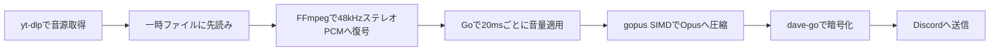

# 現行アーキテクチャ

利用者向けの挙動は[現行仕様](specification.md)、操作方法は[開発・運用手順](development.md)を参照。

## 設定と起動

CLIは入口で設定ファイル引数を1回だけ解析し、実行処理には位置引数と型付きOptionsを渡す。`os.Args`を書き換えない。管理制御には絶対パスへ正規化した設定引数を明示的に渡し、独立したコピーを保持させることで、再起動時の設定引き継ぎを維持する。

`internal/config`がkoanf v2、file/confmap Provider、dotenv Parser、厳密なYAML Parserを使って読み込む。dotenvは別のkoanfインスタンスへ保持し、プロセス環境変数優先の参照関数を構成する。YAML解析後に文字列のみ1回展開し、既定値とマージしてmapstructureの厳密なデコードと意味検証を行う。認証でApplication IDを確認してから、単一Bot用の型付きConfigをAppへ渡す。koanfや未展開の値を再生処理へ渡さない。[設定仕様](configuration.md)を参照。

## メタデータ取得と認証

操作の認可は`internal/authorization.Service`を参照し、Cedar Go v1.8.0の実装は同パッケージに閉じ込める。アプリ独自の入力・判定型を使い、CedarのEntityやスキーマ型をDiscord処理へ公開しない。設定読込時に全ルールを検証し、App初期化時に不変のポリシー集合を構築する。

Discordアダプターは評価ごとにRESTで所属ロールを取得し、Gatewayで維持するロール・チャンネル情報から閲覧権限を計算する。認可エンジン内では外部I/Oを行わない。状態変更ではセッションロック外で認可し、ロック内で対象VC・曲・世代・参加状態を照合する。キューの`access_scope`は認可対象VCを保持し、追加・再開・VC移動時に既存の保存順序制御で書き込む。[認可モデル](authorization-model.md)と[検証記録](authorization-evaluation.md)を参照。

YouTube Data APIのキャッシュは専用mutexで保護し、HTTP通信中は保持しない。キャッシュにない項目だけ通信待ちに入り、待ち終わった時点でキャッシュを再確認して重複要求を防ぐ。全件キャッシュ命中の要求は、別の通信やバックオフに待たされず補完する。

Data API補完器のキャッシュはタイトル・再生時間・チャンネル・サムネイルを一体で保持する。TrackにChannelID/ChannelTitle/ThumbnailURLを任意JSONフィールドとして保存する。チャンネルURLは検証済みIDから表示時に生成し、Discord EmbedにサムネイルURLを渡す。キュー表示はメタデータ取得を行わない。動画IDが返らなければ5分、取得済みメタデータは24時間キャッシュする。

`source.Client.YouTubeData` は任意のタイトル補完器。共通の `inspect` がyt-dlp出力をTrackへ変換した後に呼ぶため、単曲・リスト・Mix・自動再生候補へ適用される。公式APIへのHTTP処理はGo標準ライブラリを使用し、キーはヘッダーで渡す。動画IDと言語のメモリキャッシュ、50件単位の取得、最大3秒の操作期限を持つ。ゲートで同時のキャッシュミスを直列化し、先行処理の結果を再利用する。表示時や音声取得時にAPIを呼ばない。TrackのTitleSource/TitleLanguageは任意JSONフィールドであり、古い保存状態も読める。実験用yt-dlpプラグインは本番にはロードしない。

YouTubeメタデータ言語は型付きConfigから`source.Client.MetadataLanguage`へ渡し、メタデータ取得時だけ`--extractor-args youtube:lang=CODE`を追加する。ニコニコ認証・音声形式の選択とは独立している。独立診断用Clientも既定は`ja`で、設定ファイルを読む`source-check`は設定値を使用する。

`source.Client`はニコニコ認証の設定とメモリ内セッションを所有する。URL正規化後にサイトを判定し、ニコニコのメタデータ・音声取得だけに認証を適用する。Cookie方式は毎回読み取り、password方式はキャンセル可能な排他制御下でログインし、世代番号付きCookieを再利用する。認証情報は一時netrc/Cookieファイルで子プロセスへ渡し、Windows ACLまたはUnix権限で保護する。失効時の再ログインは世代を照合して重複を避け、音声出力後は再試行しない。詳細は[認証仕様](niconico-auth.md)を参照。

## Discord表示とエラー

リスト取り込み用offerに単曲のTrackを保持し、Durationをコピーして元のメタデータから独立させる。ボタン処理はこの情報を結果表示へ再利用する。source.ResultのPlaylistTitleは既存のyt-dlp出力から取得し、リスト名のための追加通信は行わない。

連続失敗通知はセッションごとの `failureNotice` で管理する。通知専用mutexで更新を直列化し、音声・キューのmutexを保持したままDiscordへ送信しない。最初の音声パケットの送信成功で進むplaybackSequenceと通知先を用いて通知のまとまりを区切る。削除済みメッセージへの更新のみ再作成し、その他のRESTエラーはログへ残して再生処理を続ける。

Discordメッセージの共通生成は `internal/discordbot/messages.go` が担当する。操作結果と公開範囲の判定をネットワーク処理から分離し、テキストとEmbedの切り替え時は不要なContent/Embeds/Componentsを明示的に空にする。入力・VC条件を遅延応答より前に検証し、公開応答開始後は公開範囲を変えない。

利用者へ表示できる操作エラーは`operationError`の固定コードで識別し、日本語表示は一か所で定義する。エラーのラップは`errors.As`で解き、外側の診断文は表示しない。上流の文字列が同じ文面でも、型が一致しなければ信用しない。認証エラーはsource側の型付き分類を使う。

`diagnostics.go`はDiscord応答の作成・更新・遅延応答と自動再生候補取得の失敗を、固定の操作名とキャンセル・タイムアウト・ネットワークなどの分類で記録する。拒否応答の送信失敗も対象とする。トークンや応答本文を含み得る上流エラーの原文は出力しない。候補取得の部分成功はエラー記録とは独立して採用する。

キューの閲覧は`queue_view.go`が担当し、セッションのロック下でEmbedとボタンを構築する。表示の直列化には再生状態と別のロックを使い、Discord応答の待機中に再生を妨げない。候補の参照は`autoplay.available`、消費は`take`へ分離する。候補取得は世代番号と完了チャネルを持つ非同期処理で、再生中の先行取得と次曲選択が共有する。無効化時は完了待機を解除し、古い取得結果を破棄する。先行取得1回と選曲時の再試行を合わせて最大2回に制限する。

## 再生セッションと接続

session.muは現在曲・接続先・自動再生・操作世代を保護する。runningは再生ループの稼働、startedは最初の音声送信完了を表す。stoppedは利用者操作や切断による停止、shuttingDownは管理保存の確定後を表し、異なる状態なので単一のフラグに統合しない。

接続開始はconnectingと対象VCを記録してからsession.muを解放する。Open完了後は停止・管理終了を再確認し、古い成功は破棄する。接続中のVC移動は接続管理の新世代へ引き継ぐ。接続中と切断後処理中は新しい開始要求を拒否する。受付時の権限確認に加え、取得後にもVC・epoch・変更受付状態を確認する。

切断時はsession.mu内で停止・接続参照の解除・closing待機チャネルの設定を行い、接続CloseとDAVE後処理を別goroutineで実行する。後処理中の追加・再接続は拒否し、旧接続の破棄が新接続へ影響しないようにする。管理終了は再生ループと切断完了の双方を待つ。切断中も状態照会はsession.muを短時間で取得できる。

再生セッションは現在曲・キュー・音量・自動再生を所有し、音声接続は安定した一つの管理オブジェクトを通して使う。実際のVC所属と復旧判断の正本は接続管理に置き、再生側のchannelは権限・通知・無人判定用の観測値として同期する。現在曲の履歴に保存した開始VCは移動しても変更しない。

`voice_connection.go`は所属・サーバー更新・通信切断・期限切れを一か所で直列化する。状態は未接続、情報待ち、接続確立中、送信可能、復旧待ち、復旧失敗、終了済みを区別する。30秒の復旧期限は内部リトライや重複通知で延長しない。接続世代を更新してから旧接続を無効化し、通信処理は状態mutexの外で実行する。4014・4022は所属変更やサーバー更新を待ち、4015では既存通信のResumeを試みる。外部退出と明示停止は自動再参加しない。トークン値を通知の識別子として使わない。移動前後で同じ値が通知される場合も、新しく受信した接続先通知を所属変更と組み合わせて使う。所属より先に届いた同値の通知は保留し、それだけでは送信可能な接続を作り直さない。

`voice_transport.go`は世代ごとのdisgo Conn・WebSocket・UDP・DAVEを所有する。disgo Connの所属変更関数は無効化しておき、通信資源の破棄がVCからの退出を送らないようにする。新しい所属とサーバー情報を組み合わせて接続し、通信暗号鍵とDAVEの準備後に送信可能にする。音声送信前に発話開始を通知する。旧世代のDAVEは別インスタンスであるため、遅い暗号化イベントから新世代の状態を書き換えられない。

音声WebSocketには`voice_socket.go`の実装を使う。disgo v0.19.6のGatewayはHeartbeat開始・終了に競合があり、Heartbeat異常時の内部再接続も接続管理の判断を迂回するため使用しない。プロトコルの型・デコードとUDPはdisgoを利用し、WebSocketの読取り・Heartbeat・送信は接続単位で終了できるようにする。Resumeでも旧接続の処理から新接続を閉じられない。DAVE通知は`voice_dave_events.go`で転送し、通信側のmutexで音声送信・資源解放と直列化する。

通信層の新規接続とResumeは別のメソッドで指定する。シーケンス未受信は-1で表し、番号0や折り返しと区別する。Resume成功後はSpeakingを次の送信前に再通知し、DAVEの準備も確認する。新規接続では前のSSRC・シーケンス・接続成立状態を初期化する。

`voice_reconnect.go`は接続管理ごとに一つの復旧処理を所有する。通常の通信断・1006・4015では既存通信を保持してResumeを最大2回試し、失敗時は新規参加要求へ進む。各Resume・参加通知待ち・退出確認は最大5秒、全体は30秒。参加通知だけが届く場合は、対象VCと参加権限を確認し、退出通知を確認してから一度だけ再参加する。自動再参加は直近5分で最大2回、明示的なOpenは別の試行として扱う。権限を確認できない場合は安全側に停止する。参加・退出要求の送信失敗は最大3回のバックオフ付き試行で打ち切り、通知待ちとは区別する。

停止・外部退出・再接続禁止の応答は復旧をキャンセルする。移動通知は古い復旧処理を無効化し、新しい所属と接続先情報を優先する。復旧中の再移動でも全体期限を延ばさない。自動退出の確認中は再生側に一時的な未所属を伝えず、現在曲と再生設定を保持する。新規接続ではDAVEを含む通信資源を作り直し、Resumeでは保持する。最終失敗時は現在曲を保持して停止し、URLなしの`/play`で曲頭から再試行する。

接続管理のWriteAudioは切り替え中に同じOpusフレームを待機させる。有限の先読みバッファで生成側にも待ちを伝え、送信成功時だけ再生位置を進める。復旧失敗は曲の失敗と区別し、再生側のsuspendVoiceLockedで現在曲・自動再生設定・履歴の同一性を保持して停止する。手動曲はキューのcurrentをFinishせず、自動曲は再開用の参照を保持する。管理保存ではRecoveryHeldを記録し、停止状態のまま復元する。明示的な /play は現在曲を先頭から再開する。

`haltPlaybackLocked`は曲の連続失敗・明示停止用で自動再生もOFFにし、`stopLocked`はVC接続も終了する。接続復旧失敗による停止とは分ける。移動後の権限・通知先・無人タイマーの更新は`voice_state.go`で行う。

## キューと永続化

`internal/history`は閲覧用履歴のSQLite保存層を担当する。moderncと`database/sql`を使い、sqlc生成コードは`internal/history/historydb`へ隔離する。再生単位IDの一意制約で再試行を重複登録せず、追加とVCごとの古い履歴削除を同一トランザクションで行う。閲覧開始時の最大IDと件数を保持し、新しい記録をページへ混入させず、保持上限による削除を検出して更新を要求する。初期スキーマは`user_version=1`とし、未知の将来版を開いて変更しない。

`internal/discordbot/history_view.go`は本人専用の履歴画面を管理する。画面ごとに元のVC、本人、メッセージID、操作世代、期限、DBスナップショットを保持し、操作時に検証する。外部取得中は同じ画面での後続操作を待たせず拒否する。再追加では単曲を再取得してからVCとセッション世代を再確認し、既存の`acceptAt`に渡す。履歴の表示モデルを再生キューとして直接流用しない。

最初の送信成功時に再生単位IDと日時を確定し、最大128件の保存待ちへコピーを渡す。DB処理はセッションのロック外の専用workerが担当する。保存は1回2秒、最大3回で打ち切る。管理チェックポイントに同じ記録を保持し、再開時には同じIDで再保存するため、保存済みなら重複せず、未保存だった場合は元の日時で再試行できる。管理終了は凍結後に最大10秒の保存待ちを行う。履歴保存の失敗は再生停止の理由にせず、ログへ記録する。

選曲済みの手動曲は、再生処理へ引き渡す前でもキューの現在曲として保存される。明示停止後のチェックポイントは、この選曲済み曲も終了させる。セッションの再生中表示への反映を待たない。

セッションのキュー保存はqueueSavingチャネルで直列化する。待機中とキューI/O中はsession.muを解放し、待機後の操作条件を再確認する。キュー操作のコールバックはセッション状態に触れない。停止・状態照会・音声送信はこの待機チャネルを使用しない。

キューはmutationMuで変更と保存順序を直列化し、muでメモリ状態を保護する。保存用JSONをmu内で確定してからmuを解放して書き込み・同期・置換を行うため、保存中もSnapshotを取得できる。変更操作は保存完了まで戻らず、PersistenceErrorも進行中の変更保存を待って結果を返す。

queueSavingは次のキュー変更と管理保存を待たせるが、停止・音声送信・状態照会は待たせない。追加保存後にはepochを再確認し、保存中に停止された場合は再生を開始しない。空の追加や容量超過では正常保存済みの内容を書き直さず、直前の保存失敗がある場合は再試行する。

## 音声パイプライン

`packet.go`は送信前の自動再生世代・手動曲優先・キャンセルを検査し、UDP Write中はsession.muを保持しない。送信完了後にもキャンセル・停止・現在曲の同一性を確認してから、開始状態・履歴・進行時間を更新する。既に許可した1パケットは停止操作と並行して送信中になり得るが、遅延完了で停止状態を再生中へ戻さない。

取得・復号は外部コマンド、音量適用・エンコード・DAVE暗号化はGoで処理する。現在の標準Botにlibopus/libdaveの動的ライブラリーは不要。旧実装との比較実験は本番の起動経路とは分離する。

ライブ再生のOpus目標ビットレートはチャンネル設定に追従する。音声ループがdisgoのチャンネルキャッシュを参照し、変更時のみ同じエンコーダーへ適用する。音声ループ内でREST通信は行わない。キャッシュ欠損・不正値は直前値を維持し、初回の既定値は96kbps。診断用FFmpeg経路は引き続き96kbps固定とする。

`internal/source`がyt-dlpをシェルを介さず起動し、`internal/music`が追加者別キューを管理します。取得した音声は1曲256MiBを上限とする一時ファイルに先読みします。ファイルへの書き込みと読み出しは並行し、全曲の取得完了を待たず再生を始めます。これにより、Discordへの送信待ちで動画サイトのHTTP接続が長時間滞留することを避けます。一時ファイルは終了・停止時に削除します。

ライブ再生ではFFmpegで48kHzステレオPCMへ変換し、送信時刻に合わせてGoで20ms分の音量処理を行い、gopus SIMDで圧縮してDAVE対応のDiscord音声接続へ送信します。エンコーダーは曲ごとに1つを維持し、音量適用済みのPCMやOpusパケットを先読みキューに蓄積しません。既存の音量カーブと10msのランプを維持し、連続操作では最新の設定を使います。正常終了時にはコーデックの遅延分をゼロ埋めして出力します。

`serve`と`build-voice`は既定で`davego,opus`タグ、`CGO_ENABLED=0`、`GOEXPERIMENT=simd`、`GOAMD64=v3`でビルドします。実行にはamd64 v3対応CPUが必要です。gopusは96kbpsでViSQOL検証済みのコミットに固定し、48kHzステレオ・20ms・チャンネル設定のビットレート・complexity 9・CVBRを指定します。DAVEには`dave-go v0.5.1`を使います。Bot本体のビルドからC/C++依存がなくなりました。音声取得・デコードには引き続きyt-dlp・FFmpegなどの外部コマンドを使います。

旧libdaveのBot起動経路は廃止した。鍵交換中は送信を保留し、30秒の接続復旧期限を超えた場合は現在曲を保持して停止する。接続破棄時にはDAVEの監視処理も終了させる。比較・相互運用の記録は[DAVE移行の検証記録](dave-go-migration.md)に残す。

通常ビルドの`render`・`stream-check`は従来のFFmpeg変換経路を使う診断用です。ライブ経路の検証には`opus-audio-check`を使ってください。停止時には取得・変換・送信をキャンセルし、遅れたフレームを取り戻すための連続送信はしません。曲の終了時に`audio pacing`ログへ送信数、20msを超える遅延の件数と最大値を出力します。

## ヘルプ表示

`internal/helpui`は再生状態に依存しないガイド・リファレンスを構築する。コマンド登録定義から書式・引数を生成し、文章と使用例は別データで管理する。同じページ一覧を直接指定、オートコンプリート、二つの選択メニューで参照する。コマンドリンク用の登録IDはGateway接続前に取得し、取得失敗時はコード表記で表示する。

`/help`とヘルプのコンポーネントは再生セッションを取得せず処理する。コンポーネントIDに所有者、表示開始から15分の期限、起動ごとの識別子を持たせる。画面移動では期限を延長せず、再起動前の画面は拒否する。個別画面の状態をサーバー側の無制限な一覧に保持しない。

## 運用ログ

トレース基盤は`internal/telemetry`が担当し、CLIでProviderを生成してAppへ注入する。SDK・OTLP/HTTP exporterはv1.47.0。既定は無効で、ログのContextに有効なSpanContextがある場合のみ`trace_id`・`span_id`・`trace_sampled`をルート属性へ追加する。処理ごとの計装は導入中であり、対象と完了条件は[計装方針](tracing-plan.md)を参照する。

送信は最大1024spanの非ブロッキングキュー、128span単位、最大1秒待ち、送信期限2秒で行う。再送は無効、終了flushは最大3秒。resourceはサービス名・バージョン・起動IDのみを出力する。環境由来のresourceはexport境界で除外し、exporterエラー原文はSDKへ渡さない。アプリ終了処理の後にProviderを終了する。

`internal/logging`が標準slog Handlerを包み、コンポーネント別のレベル判定、属性の重複解消、制御文字の処理を担当する。CLIが設定からロガーを作り、App・再生セッション・接続管理・キュー・メタデータ取得へ明示的に渡す。サーバーIDはセッションの固定属性とし、VC IDと世代は接続イベントの発生時に取得する。ロガーをContextへ格納しない。

依存ライブラリには原文・任意属性を除外するアダプターを渡す。dave-go v0.5.1には、注入ロガーをMLSへ渡さない経路と`slog.Default`を直接使う経路があるため、CLI起動時に互換用の既定ロガーを無出力にする。これらの経路から暗号処理の詳細が漏れたり、JSON出力へ別形式が混在したりすることを防ぐ。明示的に注入したロガーには影響しない。

再生開始ログは最初の音声送信成功時に、再生試行が所有する1件の通知枠へ渡す。観測処理が出力し、音声フレームはWriterを待たない。試行終了後は観測処理を回収してから次へ進む。ログ出力先の停止によるgoroutineの蓄積は許さない。`playback_id`は再生試行、`operation_id`はDiscordの操作を識別し、どちらも認証トークンではない。

接続状態の診断は接続ごとに64記録まで保持し、超過分は固定イベント種別ごとの最新状態と件数にまとめる。接続コールバックと既存のセッション定期処理が、状態ロックを解放してから出力する。音声送信処理は記録の確定だけを行う。切断時にも残る記録を回収する。通常の出力時刻と、状態を観測した`observed_at`は区別する。

アクティビティ更新失敗は所有者ごとに理由別で集約する。集約状態は最大256件、要約間隔は1分。抑制件数と継続時間を出力し、復旧時や所有者終了時に解放する。詳細な要件と移行・検証状況は[ログ改善の要件](logging-plan.md)を参照する。

## アクティビティ表示

各BotのAppがPresence更新処理を1つ所有する。再生セッションからは現在曲・送信開始済み状態をスナップショットとして読み、ネットワークを含まない表示方針の関数で曲名または空表示に変換する。設定対象と参加サーバー一覧が同じ単一サーバーの場合だけ公開する。更新処理は1秒周期で最新状態を確認し、5秒以上の送信間隔、重複抑止、失敗後の最新状態による再試行、READY/RESUMED後の再送を担当する。音声ループはPresence更新を待たない。将来は各Botの対象サーバー一覧を同じ方針関数へ渡す。

## 管理タスクによる状態復元

認証付き管理ステータスは、再生処理の稼働・音声送信開始・送信開始回数だけを追加公開する。曲名・URLは含めない。送信開始回数は各曲の最初の音声パケット送信後に増加する。`bot-restart --after-track`はビルド・事前検証後に回数を記録し、次曲の送信開始または再生停止を待って既存のチェックポイント付き停止・起動を実行する。待機中も読み取り専用の管理タスクを許可し、変更操作は排他制御する。

手動キューは変更ごとに`*-queue.json`へ保存する。管理APIの停止処理では、キャンセル前にsessionの再生状態・音量・自動再生設定を同じ状態ディレクトリの`*-playback.json`へ同期・置換して保存する。保存完了後に選曲と追加を止めるため、保存失敗なら旧プロセスは再生を継続できる。

起動時はGateway接続前に設定を読み込み、READY後にチェックポイントを消費する。`bot-restart`から起動した場合だけ、保存時に再生していたセッションを再接続する。`bot-start`では設定のみ復元する。手動曲を優先し、中断した自動再生曲は別の一時フィールドに保持する。再生位置は復元せず、各曲の先頭から再取得する。停止APIを通らない異常終了時には追加状態の保存は保証しない。

checkpointMuは管理保存要求を直列化する。状態をJSONへ確定した後、一時ファイルの書き込みとSyncはsession.mu外で行う。キュー保存完了を待ち、最新状態とepoch・自動再生revisionを照合してから最終Renameと変更受付停止を同じロック内で行う。状態変更や保存失敗があれば確定を拒否し、稼働中Botを維持する。最終Renameは依然としてロック内のファイル操作である。

履歴重複の抑制は動画ID全体の一意化ではなく、保存した再生単位の識別情報で行う。管理再開では登録済みの履歴を増やさず、新規追加は別の再生として記録する。準備中に手動曲へ譲った自動再生候補は、起点世代が同じ場合だけ候補へ戻す。

`bot-cleanup`は起動停止と同じ排他ガードとプロセス検査を使用する。既定は候補表示、`--apply`で削除する。最新3バイナリ・10ログと稼働中ファイルを保護し、キュー・設定は対象にしない。
